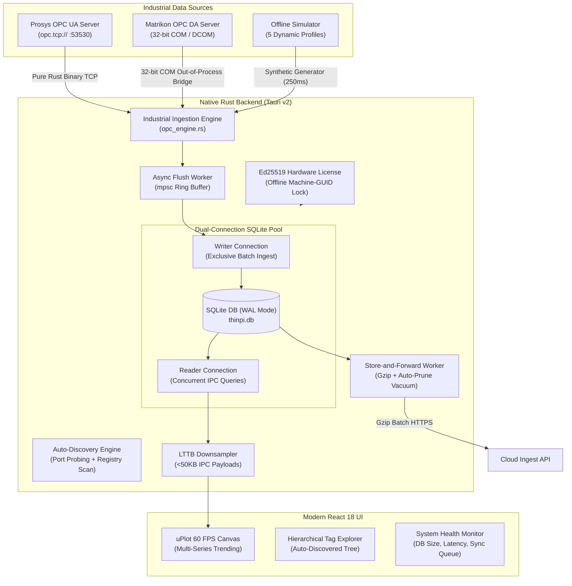

# THIN PI — Industrial Thin-Client Desktop System

> **Production-grade, ultra-lightweight Industrial Telemetry Desktop Application designed for plant shop-floors.**  
> Ingests streaming telemetry from **OPC UA** and legacy **OPC DA** servers, writes to an embedded **SQLite WAL** database, enforces **hardware-locked Ed25519 licensing**, renders 100,000+ data points at **60 FPS** via **uPlot + LTTB**, and reliably syncs data to the cloud via **Store-and-Forward**.

---

## Architecture Overview



---

## Key Capabilities & Features

### 1. Multi-Protocol Industrial Ingestion
- **Live OPC UA Client**: Pure Rust binary TCP protocol client (`HELF`/`ACKF` handshake) supporting standard endpoints (`opc.tcp://127.0.0.1:53530/...` or custom ports) with zero external OpenSSL/Perl build dependencies.
- **Legacy OPC DA 2.05a COM Bridge**: Built-in 32-bit Windows COM out-of-process worker (`opc_da_bridge.vbs`) that seamlessly interfaces with 32-bit COM servers like **Matrikon OPC Simulation Server**, **Kepware**, **Rockwell RSLinx**, and **Schneider OFS**.
- **Live Server Auto-Discovery**: Automatic network port probing and Windows Registry scan for instant 1-click server connection.
- **Built-in Offline Simulator**: 5 realistic industrial telemetry profiles (Temperature, Pressure, Flow Rate, Motor Speed, Vibration) at 250ms sampling for isolated plant testing.

### 2. Embedded High-Throughput SQLite Database
- **WAL Mode (Write-Ahead Logging)** with `PRAGMA synchronous = NORMAL`, `temp_store = MEMORY`, 64MB cache, and 256MB memory-mapped I/O.
- **Dual-Connection Pool**: Dedicated Writer connection for batch telemetry flushes and dedicated Reader connection for UI/IPC queries — completely eliminating mutex contention and database lock timeouts.
- **Crash & Power-Drop Resilient**: Guaranteed data integrity during sudden plant PC power cuts.

### 3. 60 FPS Canvas Trend Engine with LTTB Downsampling
- **uPlot High-Speed Visualizer**: Canvas-based time-series rendering capable of displaying 100,000+ data points across multiple active pens with pan, box zoom, and crosshairs.
- **LTTB (Largest Triangle Three Buckets)**: Dynamically downsamples viewport queries to ~1,500 points (<50KB JSON payloads), eliminating Tauri IPC serialization bottlenecks and rendering frames in <16ms.

### 4. Offline Hardware-Locked Cryptographic Licensing
- **Asymmetric Ed25519 Signatures**: Offline license validation using public-key cryptography.
- **Machine Hardware Binding**: Tied to the host motherboard UUID / Machine GUID via SHA-256 hashing.
- **Tiers**:
  - **Community Edition**: Up to 15 tags, full local SQLite storage and uPlot trending.
  - **Professional Edition**: Unlimited tags + Cloud Store-and-Forward synchronization.

### 5. Store-and-Forward Async Cloud Worker
- **Offline Buffering**: Telemetry records accumulate safely in SQLite during plant network dropouts.
- **Gzip Compression**: Compresses batches before uploading via HTTPS POST to reduce factory bandwidth.
- **Auto-Pruning & Vacuum**: Automatically prunes synced records older than 30 days every 6 hours and executes `PRAGMA incremental_vacuum` to keep disk footprint minimal.

---

## Tech Stack

| Layer | Technology |
|---|---|
| **Desktop Shell** | [Tauri v2](https://v2.tauri.app/) (Rust) |
| **Frontend Framework** | [React 18](https://react.dev/) + [Vite](https://vitejs.dev/) |
| **Styling & Icons** | [Tailwind CSS](https://tailwindcss.com/) + [Lucide Icons](https://lucide.dev/) |
| **High-Speed Trend Engine** | [uPlot](https://github.com/leeoniya/uPlot) (Canvas-based) |
| **Embedded Database** | SQLite via [`rusqlite`](https://crates.io/crates/rusqlite) (WAL Mode + Memory Temp Store) |
| **Industrial Ingestion** | Pure Rust Binary OPC UA TCP + 32-bit Win32 COM Bridge |
| **Licensing** | [`ed25519-dalek`](https://crates.io/crates/ed25519-dalek) + [`machine-uid`](https://crates.io/crates/machine-uid) |
| **Compression** | [`flate2`](https://crates.io/crates/flate2) (Gzip) |

---

## Project Structure

```text
THIN PI system/
├── src-tauri/                     # Rust native backend
│   ├── bin/
│   │   └── opc_da_bridge.vbs      # 32-bit Windows COM Bridge for OPC DA (Matrikon/Kepware)
│   ├── src/
│   │   ├── main.rs                # Tauri v2 application setup & IPC commands
│   │   ├── db.rs                  # SQLite WAL dual-connection pool & schema management
│   │   ├── opc_engine.rs          # Multi-protocol ingestion engine (OPC UA, DA, Simulator)
│   │   ├── lttb.rs                # Largest Triangle Three Buckets downsampling algorithm
│   │   ├── license.rs             # Ed25519 hardware-locked licensing engine
│   │   ├── sync_worker.rs         # Store-and-Forward worker with Gzip & auto-vacuum
│   │   └── models.rs              # Shared serializable data models
│   ├── icons/                     # Complete application icon suite
│   ├── Cargo.toml                 # Rust dependencies & metadata
│   └── tauri.conf.json            # Tauri v2 desktop configuration
├── src/                           # React frontend
│   ├── components/
│   │   ├── ConnectionPanel.jsx    # Industrial Connection Manager & Auto-Discovery UI
│   │   ├── TagTree.jsx            # Hierarchical Tag Explorer tree
│   │   ├── TrendChart.jsx         # uPlot high-frequency time-series chart
│   │   ├── StatusBar.jsx          # Live telemetry rate, DB size, and latency HUD
│   │   └── LicenseModal.jsx       # License key activation modal
│   ├── App.jsx                    # Main application container
│   ├── index.css                  # Tailwind styles & industrial dark theme
│   └── main.jsx                   # React DOM entry point
├── package.json                   # Frontend dependencies & scripts
├── vite.config.js                 # Vite bundler configuration
└── README.md                      # Project documentation
```

---

## Getting Started

### Prerequisites
- **Node.js**: `v18+` or `v20+`
- **Rust Toolchain**: `stable` (MSVC toolchain on Windows)
  ```powershell
  rustup default stable-x86_64-pc-windows-msvc
  ```

### 1. Install Dependencies
```powershell
npm install
```

### 2. Run in Development Mode
```powershell
npm run tauri dev
```

### 3. Build Production Installer
```powershell
npm run tauri build
```
The compiled release executable and installer will be generated in `src-tauri/target/release/bundle/`.

---

## How to Connect to Industrial Servers

### 1. Prosys OPC UA Simulation Server
1. Launch the Prosys OPC UA Simulation Server.
2. In THIN PI's **Connection Manager**, click **"Connect to Prosys (OPC UA)"** (or use `opc.tcp://127.0.0.1:53530/OPCUA/SimulationServer`).
3. The live Prosys address space (`Objects > Simulation > [Counter, Random, Sawtooth, Sinusoid, Square, Triangle]`) will appear in the Tag Explorer.

### 2. Matrikon OPC DA Simulation Server
1. Ensure `MatrikonOPC Server for Simulation and Testing` is running.
2. In THIN PI's **Connection Manager**, click **"Connect to Matrikon (OPC DA)"** (or use `opc.da://Matrikon.OPC.Simulation.1`).
3. The Matrikon tag categories (`Random`, `Saw-toothed Waves`, `Triangle Waves`, `Bucket Brigade`) will appear in the Tag Explorer.

### 3. Built-in Offline Simulator
1. In the sidebar, click **"Start Offline Simulator"**.
2. Five synthetic industrial tags (Temperature, Pressure, Flow Rate, Motor Speed, Vibration) will stream immediately at 250ms sampling.

---

## Automated Test Suite

Run the full Rust backend unit test suite:
```powershell
cd src-tauri
cargo test
```

Expected output:
```text
running 6 tests
test license::tests::test_hardware_id_consistency ... ok
test license::tests::test_invalid_license_rejected ... ok
test lttb::tests::test_passthrough_small_data ... ok
test lttb::tests::test_multi_series_alignment ... ok
test lttb::tests::test_downsample_preserves_endpoints ... ok
test license::tests::test_dev_license_roundtrip ... ok

test result: ok. 6 passed; 0 failed; 0 ignored; finished in 0.02s
```

---

## License

Copyright © 2026 THIN PI System. All rights reserved.
Protected under Ed25519 cryptographic hardware licensing.
